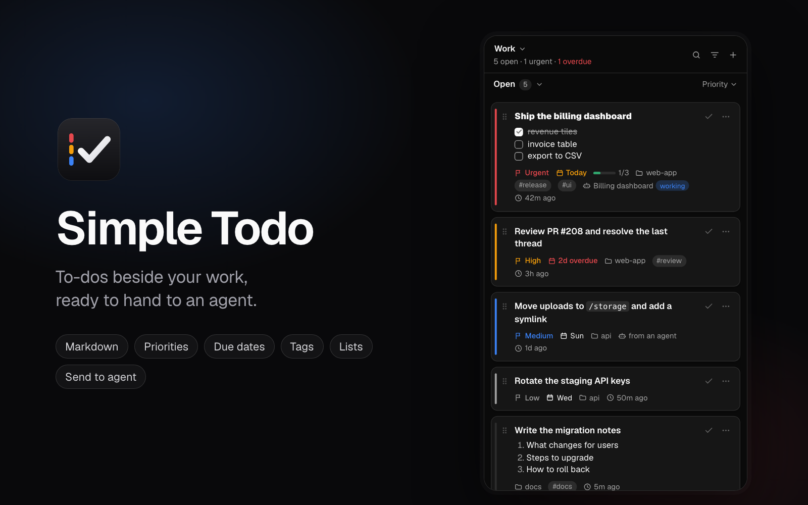

# Simple Todo

A to-do list in [Orca](https://www.onorca.dev)'s right sidebar: Markdown to-dos with priorities, due days, tags and lists, that you can hand to an agent and follow.



## Install

In Orca, open Settings → Plugins and search for `simple-todo`, or run:

```sh
orca plugin install csavur/simple-todo
```

Orca lists the access the plugin asks for (see [Access](#access)) and installs it once you approve.

## Features

- **Markdown to-dos**: a multi-line editor with a preview. Type `/` for a menu of headings, lists, checklists, quotes, code and emphasis. Enter continues a list. Tick boxes in a to-do can be ticked right in the list, and the card shows how many are done.
- **Priorities and due days**: Urgent, High, Medium, Low, and an optional due day shown as "Today", "Tomorrow" or "2d overdue". A desktop notification says when a to-do becomes due.
- **Projects and tags**: tag a to-do with one of your Orca projects (paired Orca servers included) or any name you type, and with free tags such as `#bug`.
- **Lists**: several named lists; the list's name at the top opens the menu to switch, add, rename and delete them.
- **Find and order**: a status dropdown (open, done, all, archived), a search box, a filter menu for projects, priorities, tags and due days, and sorting by priority, due day or age. Drag a to-do by its handle to keep your own order.
- **Send to an agent**: hand a to-do to an agent already running in a terminal, in any workspace or on a paired server, or start a new agent with it. The card then shows what that agent is doing, and can mark the to-do done when the agent finishes.
- **From an agent**: ask a coding agent to add a to-do and it lands in the list. The plugin installs the skill that tells agents how (see [Agents](#agents)).
- **Housekeeping**: undo after deleting, clearing, archiving and importing; done to-dos are archived after a number of days; export a list as Markdown or everything as a JSON backup, and import either.
- **Quick add and status bar**: Cmd+Alt+/ opens the form for a new to-do. The status bar shows how many are open, flagged when any is urgent or overdue.

Tasks are stored on this machine only, in the plugin's own storage.

## Agents

Coding agents can add to-dos for you. Ask one in plain words, and name Simple Todo so it knows which list you mean:

```
Add a to-do to Simple Todo: check the login redirect, high priority, due tomorrow
Note the follow-ups from this in Simple Todo
```

The to-do shows in the panel within a few seconds, marked "from an agent". You can give a priority, a project, tags and a due day. Agents can only add: they cannot list, tick or delete to-dos.

### The skill

Agents learn how from the `simple-todo` skill, [skills/simple-todo/SKILL.md](skills/simple-todo/SKILL.md). There are two ways to install it; use either.

**With the plugin (nothing to do).** "Let agents add to-dos", under the plugin in Orca's Settings, is on by default. While it is on, the plugin keeps the skill in `~/.agents/skills/simple-todo`, where opencode, pi and other agents that read the shared skills folder find it, and links it into `~/.claude/skills` for Claude Code. It updates the skill when the plugin updates and removes it when you turn the setting off.

**Yourself.** If you keep your agents' skills in your own setup, turn the setting off and install the skill with the [skills CLI](https://github.com/vercel-labs/skills):

```sh
npx skills add csavur/simple-todo
```

or copy `skills/simple-todo` from this repository into your agent's skills folder (your dotfiles, `~/.claude/skills`, a project's `.claude/skills`).

Either way, start a new agent session afterwards: agents read their skills when a session starts.

The two ways do not fight. The plugin only touches a copy it wrote and nobody changed since: a `simple-todo` skill you installed or edited is left alone, and so is a skills folder it cannot write to. `orca plugin logs` says when that happens.

### How it works

The skill tells the agent to append a line such as `- [ ] Fix the login redirect !high @web #bug due:tomorrow` to `~/.simple-todo/inbox.md`. The plugin takes the lines in, into the list being shown. Lines appended while Orca is closed wait for it. Any tool that can append to that file can add to-dos the same way; "Copy instructions for agents" in the list menu gives the format as text.

The inbox is on the machine the agent runs on, so this reaches agents on this machine, not those on a paired Orca server or an SSH host.

## Access

The plugin runs a worker (`trusted-worker`), which Orca keeps running to update the status bar.

| Capability | Used for |
|---|---|
| `storage:own` | The task list |
| `workspace:read` | Listing your Orca projects and their workspaces |
| `workspace:write` | Opening a workspace when you press a task's project |
| `agent:read` | Listing the agents running in the focused workspace |
| `agent:launch` | Starting a new agent with a task |
| `terminal:send` | Sending a task to a running agent |
| `notifications:show` | Reminding you when a to-do is due |
| `settings:own` | The options under the plugin in Orca's Settings |

Projects on a paired Orca server belong to another Orca runtime, which the plugin API does not reach. For those the worker runs the `orca` CLI that ships with the app (`environment list`, `repo list`, `worktree list`, `worktree ps`, `terminal list`, `terminal send`, `worktree activate`, `agent launch` and `plugin open`). The CLI acts with your own access, outside the capability list above.

The worker also touches three places in your home folder, outside the capability list too: it reads `~/.simple-todo/inbox.md`, and, while "Let agents add to-dos" is on, writes `~/.agents/skills/simple-todo` and a link to it in `~/.claude/skills`.

## Develop

There is no build step: Orca loads the TypeScript as written.

```sh
orca plugin dev reload .          # load the folder's current files into Orca
orca plugin test .                # unit tests for the rules, markup, worker and helpers
```

Keep generated files out of this folder: Orca checks the folder's contents before it starts the
worker, and a `.orca/` folder (typings, screenshots) left here fails that check. Remove it after a
reload, and save screenshots elsewhere with `orca plugin shot <key> --out <file>`.

The panel draws its own HTML (`panel/index.html`, `panel/panel.css`) on Orca's theme variables, so
it can have popovers and menus that Orca's component kit lacks. Its markup is built by pure
functions (`src/ui/view.ts`) from a plain state object (`src/ui/state.ts`), which is what the tests
check; `src/ui/main.ts` is the only part that touches the DOM and Orca.

## Licence

MIT, see [LICENSE](LICENSE). The bundled font, `panel/fonts/Geist-Variable.woff2`, is Geist by Vercel under the SIL Open Font License 1.1, see [panel/fonts/OFL.txt](panel/fonts/OFL.txt).

## Layout

```
assets/            the plugin's icon and cover image
panel/             the page, its stylesheet and font
skills/            the skill that tells agents how to add a to-do
src/
├── core/          shared by the panel and the worker: data model, list functions, Markdown
├── ui/            the panel: state rules, markup, and the script that wires them to Orca
├── worker/        the `orca` CLI runner, paired-server projects, running agents, the inbox, the skill installer, and the timed chores
├── protocol.ts    the requests the panel makes of the worker
└── worker.ts      status bar, palette command, workspaces and agents
```
